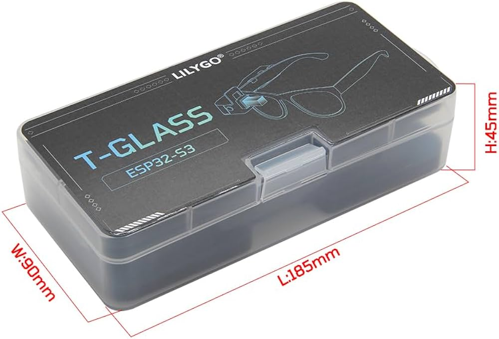

# LILYGO T-Glass Drive Assistant

A port of **Drive Assistant** to the **LILYGO T-Glass** ESP32-S3 smart glasses.

The project brings bicycle navigation information from the Drive Assistant Android app to the small display in the T-Glass. Since the T-Glass has no touchscreen, the user interface is operated using its physical button.

<p align="center">
  
</p>

## Demo

The video below demonstrates Drive Assistant running on the LILYGO T-Glass.


https://github.com/user-attachments/assets/ee2b0041-24aa-45e2-9968-7806869983f6


## Hardware

- **Board:** LILYGO T-Glass
- **MCU:** ESP32-S3
- **Display:** AMOLED, 126 × 126 pixels visible through the prism
- **Input:** Physical button (no touchscreen)

## Controls

The physical button replaces the touchscreen interaction:

| Button action | Function |
|---|---|
| Single click | Switch screen / Play or Pause on the media screen |
| Double click | Previous screen / Next title on the media screen |
| Triple click | Previous title on the media screen |
| Long press | Switch the display on or off |

## Installation and setup

This project is based on [Drive Assistant by DEMP1993](https://getdriveassistant.com/).

### 1. Flash the firmware

A precompiled `.BIN` file can be flashed to the ESP32-S3 using `esptool.py`.

**Linux:**

```bash
python3 ~/.arduino15/packages/esp32/tools/esptool_py/4.5.1/esptool.py \
  --chip esp32s3 \
  --port /dev/ttyACM3 \
  --baud 460800 \
  write_flash \
  0x0 \
  ~/Arduino/Drive-Assistant/Drive-Assistant.bin
```

Replace the paths to `esptool.py` and `Drive-Assistant.bin`, as well as `/dev/ttyACM3`, with the paths and serial port used on your system.

### 2. Install the Android app

Download the [Drive Assistant Android app](https://github.com/DEMP1993/Drive-assistant-android-app).

1. Install `DriveAssistant-0.21.apk`.
2. Start the app.
3. Follow the setup instructions in the app.

## Original project and credits

This project is based on [Drive Assistant](https://getdriveassistant.com/) by **DEMP1993**.

Special thanks to DEMP1993 for the original project. Please support his work:

- [Drive Assistant project](https://getdriveassistant.com/)
- [Android app repository](https://github.com/DEMP1993/Drive-assistant-android-app)
- [Drive Assistant Zero Kit – bicycle navigation](https://www.tindie.com/products/demp1993/drive-assistant-zero-kit-bicycle-navigation/)

---

*The original README.txt installation instructions have been retained and incorporated into this document.*
